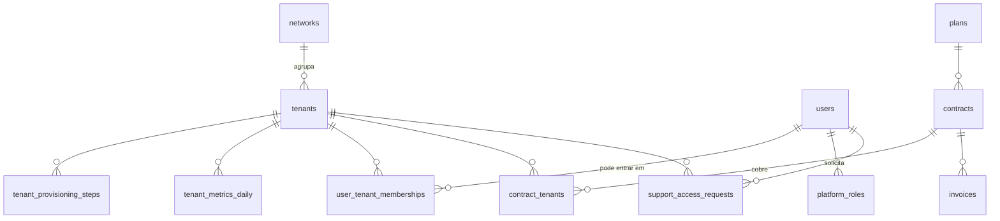
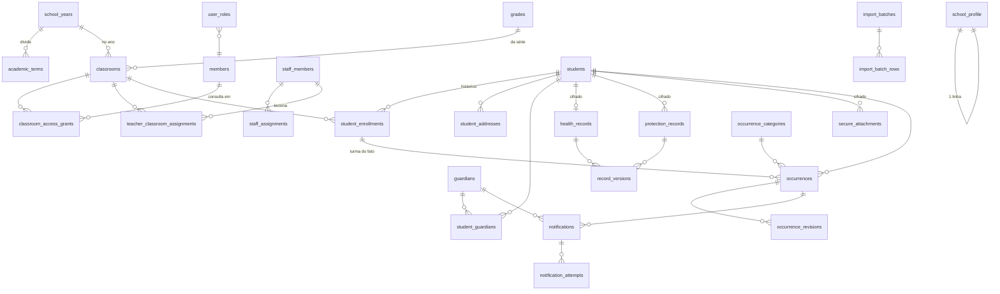

# Modelo de dados — Sinedu MVP

Dois tipos de banco PostgreSQL ([ADR 0002](../adr/0002-multi-tenancy-subdominio.md)):

| Banco | Quantidade | Conteúdo |
|-------|-----------|----------|
| `sinedu_platform` | 1 | Contas, escolas (registro), redes, planos, contratos, faturas, métricas, auditoria da plataforma |
| `sinedu_t_{slug}` | 1 por escola | Todos os dados da escola: equipe, alunos, ocorrências, módulos protegidos, importações, auditoria |

Convenções gerais:

- PK `id uuid` (UUID v7 gerado na aplicação), exceto tabelas de auditoria (`bigint identity`).
- Tabelas editáveis: `created_at`, `created_by`, `updated_at`, `updated_by`; `xmin` como token de concorrência otimista.
- Dados importáveis: `source` (`manual`/`import`/`connector`), `last_import_batch_id`.
- `timestamptz` em UTC; `date` para datas civis. Enums como `text` + `CHECK`.
- **Não há `school_id` nas tabelas da escola**: o banco já é a escola. `created_by`/`user_id` referenciam o `id` da conta no banco da plataforma (`sub` do OIDC), sem FK entre bancos.

---

## Parte A — `sinedu_platform`

### Escolas e redes

| Tabela | Colunas principais | Observações |
|--------|-------------------|-------------|
| `networks` | name, kind (`ESTADUAL`/`MUNICIPAL`/`PARTICULAR`/`OUTRA`), uf, municipality | Só agrupamento e contratos (D5). |
| `tenants` | slug (único), display_name, network_id, institutional_code (INEP), status (`provisionando`/`falha_provisionamento`/`ativa`/`suspensa`/`encerrando`/`encerrada`), status_reason, db_name, db_secret_path (Vault), transit_key_name, bucket_name, schema_version, suspended_at, closing_started_at, closed_at | **Não guarda senha de banco**, só o caminho no Vault. |
| `reserved_slugs` | slug | `painel`, `conta`, `api`, `www`, ... |
| `tenant_provisioning_steps` | tenant_id, step, status, started_at, finished_at, error_sanitized | Passos idempotentes do provisionamento. |
| `tenant_migration_runs` | tenant_id, from_version, to_version, status, started_at, finished_at, error_sanitized | |
| `tenant_metrics_daily` | tenant_id, day, active_students, classrooms, active_users, occurrences_month, storage_bytes, emails_sent_month, failed_jobs | Só números (P13). |

### Identidade

| Tabela | Colunas principais | Observações |
|--------|-------------------|-------------|
| `users` | email (`citext` único), full_name, password_hash, status (`convidado`/`ativo`/`desativado`), mfa_required, totp_secret_enc, failed_login_count, lockout_until, last_login_at, account_kind (`escola`/`plataforma`) | `account_kind = plataforma` não pode ter memberships (D19). |
| `platform_roles` | user_id, role (`SUPER_ADMIN`/`SUPORTE`), granted_by, granted_at, revoked_at | |
| `user_recovery_codes` | user_id, code_hash, used_at | |
| `user_tenant_memberships` | user_id, tenant_id, is_privileged, active, synced_at | **Só** "pode entrar em". `is_privileged` = tem papel que exige MFA (para o `conta.` forçar). Papéis reais ficam no banco da escola. |
| `user_invitations` | email, tenant_id (nullable), invited_role_hint, token_hash, expires_at, accepted_at | Convite cria/ativa a conta; o papel é gravado pela escola. |
| `password_reset_tokens` | user_id, token_hash, expires_at, used_at | |
| `oidc_*` | tabelas do OpenIddict (aplicações, autorizações, tokens) | |

### Cobrança

| Tabela | Colunas principais | Observações |
|--------|-------------------|-------------|
Schema `billing` (implementado no P-06..P-09, conforme as decisões de cobrança):

| Tabela | Colunas principais | Observações |
|--------|-------------------|-------------|
| `plans` | name (único), is_active | Valor fixo por faixa de alunos ativos. |
| `plan_tiers` | plan_id, up_to_students (nulo = "acima de"), monthly_price | Só a última faixa pode ser aberta. |
| `contracts` | tenant_id, plan_id, payer_name, payer_document (CNPJ), payer_contact_name, payer_email, payer_phone, starts_on, ends_on, due_day (1–28), status (`Active`/`Ended`/`Cancelled`), notes | Pagante = APMF da escola. Um contrato ativo por escola no período. |
| `invoices` | contract_id, tenant_id, reference_month, students, tier_label, amount, due_on, status (`Open`/`Paid`/`Cancelled`), invoice_number, issued_on, paid_on, paid_amount, notes | Uma válida por contrato e mês (cancelada pode ser gerada de novo). "Vencida" é calculada. Guarda a contagem e a faixa usadas. |

Alertas não têm tabela: são calculados na consulta (fatura vencida, contrato vencendo/vencido, escola sem contrato, acima da última faixa).

### Suporte e auditoria

| Tabela | Colunas principais | Observações |
|--------|-------------------|-------------|
| `support_access_requests` | tenant_id, requested_by, reason, duration_hours (≤ 24), status (`pendente`/`aprovado`/`recusado`/`expirado`/`revogado`), decided_by_user_id, decided_at, expires_at | A decisão é tomada na escola e espelhada aqui. |
| `platform_audit_events` | id bigint, occurred_at, user_id, action, tenant_id, target_type, target_id, result, ip, correlation_id | Append-only. |
| `jobs` | type, tenant_id, payload (só IDs), status, run_after, attempts, locked_until, last_error | Provisionamento, migrations, métricas, alertas. |

---

## Parte B — `sinedu_t_{slug}` (banco de cada escola)

### Schema `access`

| Tabela | Colunas principais | Observações |
|--------|-------------------|-------------|
| `members` | user_id (= `sub` da plataforma), display_name, email, status | Cópia local mínima de quem tem acesso a esta escola. |
| `user_roles` | user_id, role (`DIRETOR`/`PEDAGOGO`/`ADMIN_TECNICO`/`PROFESSOR`/`CONSULTA`/`SUPORTE_PLATAFORMA`), granted_by, granted_at, expires_at, revoked_at, revoked_by | `expires_at` obrigatório para `SUPORTE_PLATAFORMA`. Único (user_id, role) ativo. |
| `classroom_access_grants` | user_id, classroom_id, granted_by, granted_at, revoked_at | Escopo do perfil CONSULTA. |
| `support_access_grants` | platform_request_id, requested_by, reason, decided_by, decision, decided_at, expires_at, revoked_by, revoked_at | Origem da liberação de suporte. |
| `user_sessions` | user_id, created_at, last_seen_at, auth_time, expires_at, revoked_at, ip, user_agent | Sessões do cookie `__Host-` desta escola. |

### Schema `school`

| Tabela | Colunas principais | Observações |
|--------|-------------------|-------------|
| `school_profile` | name, institutional_code, address_*, phone, email, logo_object_key, document_header, timezone | Linha única. |
| `school_years` | year, starts_on, ends_on, status (`planejado`/`ativo`/`encerrado`) | Único por `year`. |
| `academic_terms` | school_year_id, number, name, starts_on, ends_on | Exclusão de sobreposição no mesmo ano. |
| `grades` | name, code, sort_order | |
| `classrooms` | school_year_id, grade_id, name, shift, capacity, status, external_code | Único (school_year_id, name). |
| `staff_members` | full_name, user_id (nullable), professional_email, professional_phone | Pode existir sem conta (vindo de importação). |
| `staff_assignments` | staff_member_id, function (`DIRETOR`/`PEDAGOGO`/`PROFESSOR`/`OUTRO`), starts_on, ends_on | Informativo (painel do aluno). Permissão vem de `access.user_roles`. |
| `teacher_classroom_assignments` | staff_member_id, classroom_id, subject, starts_on, ends_on | Escopo do professor. |

### Schema `students`

| Tabela | Colunas principais | Observações |
|--------|-------------------|-------------|
| `students` | full_name, social_name, birth_date, institutional_code (ex.: CGM), status, source, last_import_batch_id | Nenhuma coluna sensível. Índice trigram em `full_name`. |
| `student_enrollments` | student_id, classroom_id, school_year_id, status (`ativa`/`transferida`/`concluida`/`cancelada`/`remanejada`), starts_on, ends_on, external_number | Encerrar e abrir nova; nunca sobrescrever. |
| `student_addresses` | student_id, street, number, complement, district, city, uf, postal_code, valid_from, valid_to, source | Versionado por vigência. |
| `guardians` | full_name, phone_primary, phone_secondary, email, source | |
| `student_guardians` | student_id, guardian_id, relationship, is_primary_contact, contact_authorized, contact_basis, contact_authorized_at, contact_authorized_by | N:N. Autorizar exige fundamento (spec 6.1). |

### Schema `protected` — só o módulo ProtectedRecords acessa

| Tabela | Colunas principais | Observações |
|--------|-------------------|-------------|
| `health_records` | student_id (único), current_version, review_due_on | |
| `protection_records` | student_id, kind, status (`vigente`/`revogada`/`expirada`), valid_until, current_version | `kind`, `status`, `valid_until` em claro (P3). |
| `record_versions` | record_kind (`Health`/`Protection`), record_id, student_id, version, payload_schema_version, ciphertext, nonce, tag, wrapped_key, created_by, created_by_name, created_at | Versões imutáveis das duas fichas. O envelope guarda dados **e** motivo da alteração. Saúde: tipo sanguíneo, alergias, condições, medicamentos, restrições, primeiros cuidados, contatos de emergência, origem. Proteção: título, descrição, autoridade, documento, fundamentação, verificação, pessoas autorizadas/impedidas, observações. A versão da chave vem no prefixo `vault:vN:` da DEK. |
| `secure_attachments` | student_id, owner_kind, owner_id, object_key, nonce, tag, wrapped_key, metadata (envelope próprio: nome, tipo, descrição), size_bytes, ciphertext_sha256, created_by, removed_at | Objeto no S3 em `protected/{id}`, só ciphertext. |
| `exports` | student_id, sections, justificativa (envelope), created_by, created_at | Exportações excepcionais. |

### Schema `occurrences`

| Tabela | Colunas principais | Observações |
|--------|-------------------|-------------|
| `categories` | name, is_active, sort_order | Seed padrão na migration (categorias da spec). |
| `severities` | name, sort_order | Leve, Moderada, Grave. |
| `occurrences` | student_id, enrollment_id, classroom_id, school_year_id, occurred_at, category_id, severity_id, location, description, involved, actions_taken, referrals, status (`Rascunho`/`Registrada`/`EmAcompanhamento`/`Concluida`/`Cancelada`), created_by(_name), registered_at/by, concluded_at, cancelled_at, cancel_reason, notes, version, xmin | Turma **da data do fato** gravada no registro. |
| `revisions` | occurrence_id, version, action, snapshot (jsonb), reason, changed_by(_name), changed_at | Estado completo depois de cada mudança formal. |
| `attachments` | occurrence_id, object_key, file_name, content_type, size_bytes, sha256, uploaded_by(_name), removed_at | |

### Schema `notifications`

| Tabela | Colunas principais | Observações |
|--------|-------------------|-------------|
| `templates` | channel, name, subject, body, is_active, sort_order | Só marcadores neutros. |
| `notifications` | occurrence_id, student_id, guardian_id, recipient_name, channel, recipient_address, template_id, rendered_subject, rendered_body, authorized_by(_name), authorized_at, status, attempts, next_attempt_at, sent_at, provider_message_id, last_error (sanitizado), idempotency_key (único), cancelled_at | |
| `attempts` | notification_id, attempt_no, trigger (envio/reenvio automático/manual), started_at, finished_at, succeeded, provider_message_id, error_sanitized | |

### Schema `imports`

| Tabela | Colunas principais | Observações |
|--------|-------------------|-------------|
| `import_batches` | kind, file_name, file_object_key, file_sha256, status, mapping (jsonb), totals (jsonb), created_by, confirmed_by, timestamps | |
| `import_batch_rows` | batch_id, row_number, normalized_data (jsonb), action, target_entity_id, errors (jsonb, mascarado), resolved_by | Dados brutos expurgados em 90 dias (P5). |
| `import_match_candidates` | row_id, candidate_student_id, score, reasons, decision | |
| `column_mapping_presets` | kind, name, mapping | Ex.: preset "Relatório SERE — alunos". |
| `external_source_references` | entity_type, entity_id, source_system, external_id | Único (source_system, entity_type, external_id). |

### Schemas `audit`, `infra`, `metrics`

| Objeto | Descrição |
|--------|-----------|
| `audit.audit_events` | id bigint, occurred_at, user_id, student_id, action, resource_type, resource_id, result, is_support_session, ip, correlation_id. Append-only. |
| `infra.jobs` | Fila da escola (e-mails, importações). Payload só com IDs. |
| `infra.schema_info` | Versão de schema aplicada. |
| `metrics.v_counts` | View só com números agregados. **Único objeto que o papel de métricas da plataforma pode ler.** |

## Papéis de banco por escola

| Papel | Acesso |
|-------|--------|
| `t_{slug}_app` | Usado pelo Tenant.Host. CRUD nos schemas da escola; só `INSERT`/`SELECT` em `audit`. |
| `t_{slug}_migrator` | DDL, usado só pelo executor de migrations da plataforma. |
| `sinedu_metrics` | `SELECT` em `metrics.v_counts` de todos os bancos de escola. Nada mais. |

Senhas no Vault; nenhum papel de leitura geral para suporte ou BI.

## Índices relevantes

- `students (full_name gin_trgm_ops)`, `students (institutional_code)`.
- `student_enrollments (classroom_id, status)`, `(student_id, starts_on)`.
- `occurrences (occurred_at)`, `(classroom_id, occurred_at)`, `(student_id, occurred_at)`.
- `teacher_classroom_assignments (staff_member_id, classroom_id)`.
- `access.user_roles (user_id) WHERE revoked_at IS NULL`.
