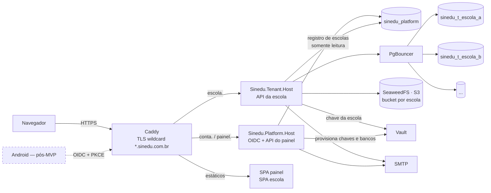
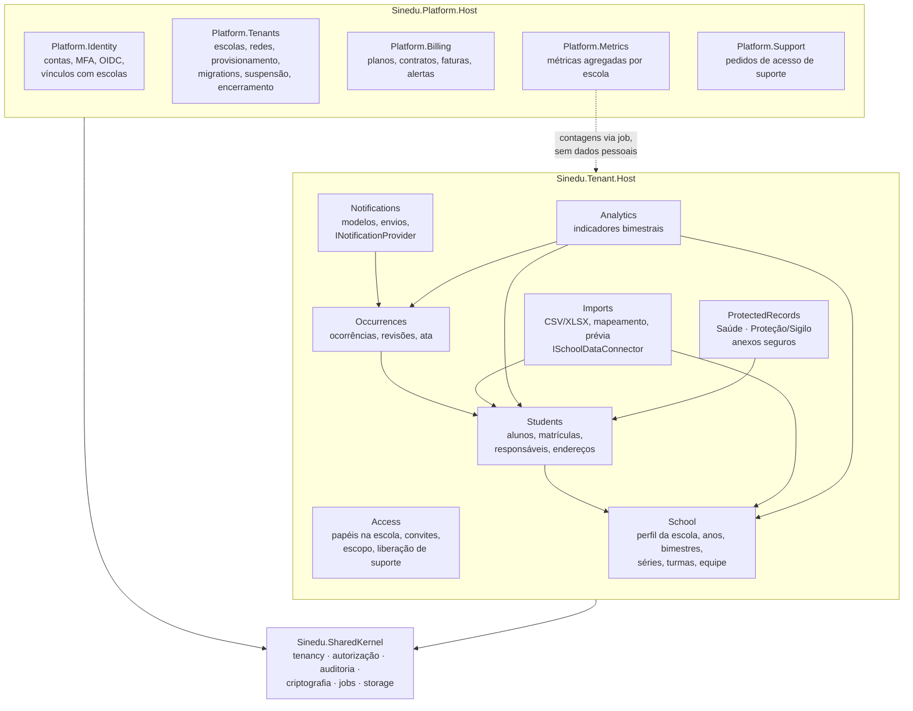
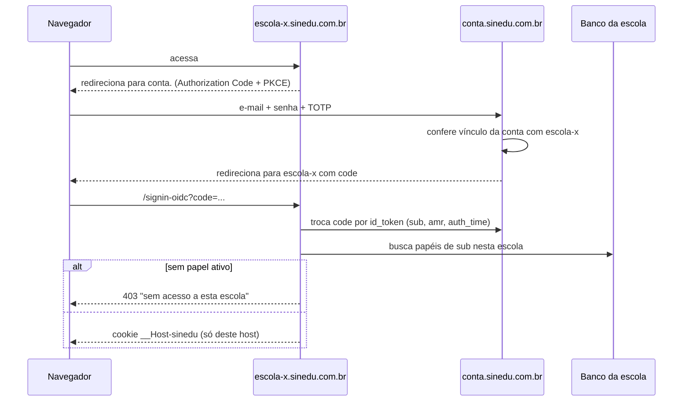
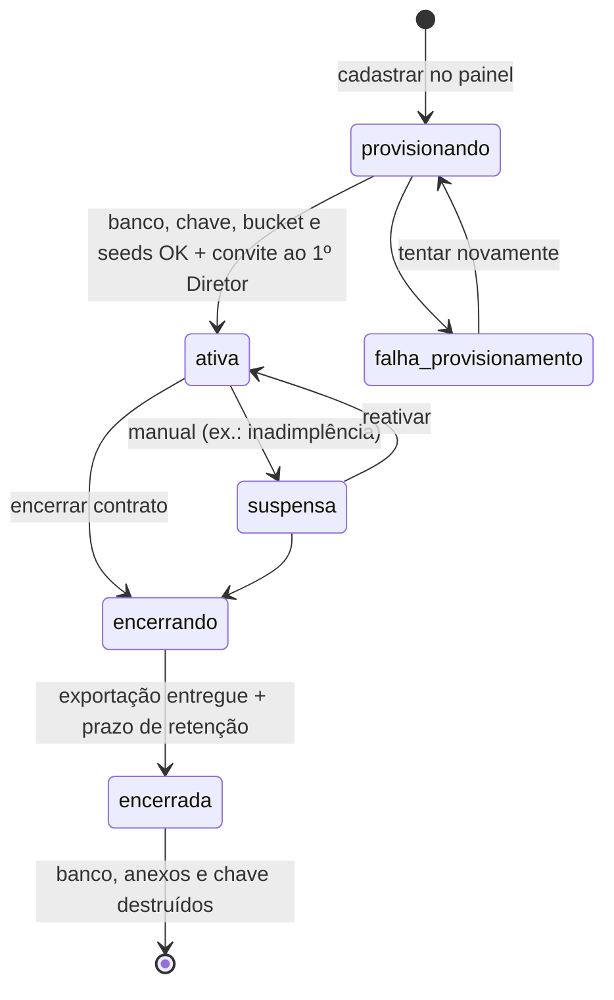
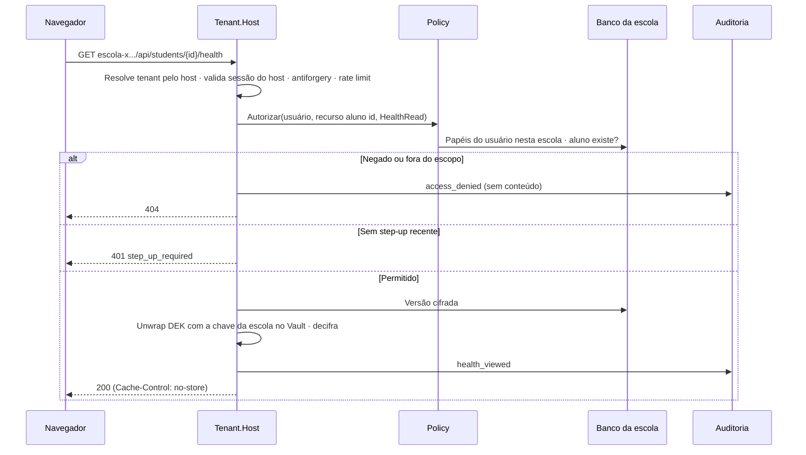

# Arquitetura — Sinedu MVP

Documentos relacionados: [modelo de dados](modelo-de-dados.md) · [matriz de permissões](matriz-de-permissoes.md) · [backlog](backlog.md) · [decisões](../decisoes-mvp.md) · [ADR 0002](../adr/0002-multi-tenancy-subdominio.md)

## 1. Resumo

- **Plataforma multi-tenant**: cada escola é um tenant em `{slug}.sinedu.com.br`, com **banco PostgreSQL, papel de banco e chave de criptografia próprios**.
- **Plano de controle** separado (`sinedu_platform`): registro de escolas, redes, identidade única, planos, contratos e faturas.
- **Três superfícies web**:

| Endereço | Para quem | O que é |
|----------|-----------|---------|
| `conta.sinedu.com.br` | todos | Login único (OIDC), MFA, recuperação de senha, escolha de escola |
| `painel.sinedu.com.br` | dono da plataforma e suporte | Painel gerencial: escolas, redes, provisionamento, contratos, faturas, métricas |
| `{escola}.sinedu.com.br` | equipe da escola | A aplicação escolar da spec |

- **Dois executáveis** do mesmo monólito modular: `Sinedu.Platform.Host` (conta + painel) e `Sinedu.Tenant.Host` (escolas).
- Na escola, **segurança em camadas**: tenant pelo host → sessão do host → papel no banco da escola → policy por recurso → DTO explícito → auditoria. `deny by default`.

## 2. Resolução de tenant

1. Caddy recebe `escola-x.sinedu.com.br` e encaminha ao Tenant.Host preservando o `Host`.
2. `TenantResolutionMiddleware` extrai o slug, ignora subdomínios reservados e busca no registro (cache em memória de 60 s, invalidado quando o painel altera a escola).
3. Escola inexistente → página 404 genérica. Escola `suspensa`/`encerrada` → página de indisponibilidade, sem login (P12).
4. Monta o `TenantContext` (id, slug, connection string vinda do Vault, chave Transit, bucket, versão de schema esperada).
5. Os `DbContext` dos módulos são criados por requisição com a conexão **daquela** escola. Não existe caminho de código que abra conexão com escola diferente da do host.
6. A sessão (cookie `__Host-sinedu`) carrega o `tenant_id`; se não bater com o host → sessão descartada e `401`.

Jobs em segundo plano recebem o `tenant_id` explicitamente e montam o mesmo `TenantContext`.

## 3. Módulos

**Regras de dependência**

- Nenhum módulo lê tabelas de outro; usa contratos públicos (`IStudentDirectory`, `IClassroomDirectory`...).
- **Nenhum módulo depende de `ProtectedRecords`.**
- **O Platform.Host nunca abre conexão com banco de escola**, exceto: (a) o executor de provisionamento e migrations, que só executa DDL, e (b) o coletor de métricas, que usa um papel de banco que só lê **views de contagem** (`metrics.v_counts`). Nenhum dos dois tem acesso ao schema `protected` nem às tabelas de alunos.
- Teste de arquitetura (NetArchTest) garante essas regras no CI.

## 4. Identidade e login único

| Item | Decisão |
|------|---------|
| Provedor | OpenIddict no Platform.Host. Cada escola é o mesmo cliente OIDC com `redirect_uri` validada contra o registro de escolas. |
| Contas | Em `sinedu_platform.users`: e-mail, hash Argon2id, TOTP cifrado, códigos de recuperação. |
| Vínculo conta↔escola | `platform.user_tenant_memberships` só diz **em quais escolas** a conta pode entrar (para listar e validar o login). **Papéis ficam no banco da escola.** A escola mantém o vínculo sincronizado ao conceder/revogar papéis. |
| Sessão na escola | Cookie `__Host-` (só aquele host), inatividade 30 min, máximo 10 h, revogável. Logout local + logout no `conta.`. |
| Troca de escola | Menu lista as escolas da conta; ir para outra escola faz o fluxo OIDC silencioso (sessão do `conta.` ainda ativa). |
| Step-up | Rotas de Saúde/Proteção exigem `auth_time` ≤ 15 min; senão a escola pede reautenticação ao `conta.` com `max_age=0`. |
| MFA | Obrigatório conforme D6; o `conta.` exige se a conta tiver papel privilegiado em qualquer escola (a escola informa isso ao sincronizar o vínculo) ou for conta de plataforma. |
| Painel | Contas de plataforma (`SUPER_ADMIN`, `SUPORTE`) entram no `painel.` pelo mesmo `conta.`, com MFA obrigatório. **Não podem ter papéis em escolas** (D19). Lista de IPs permitidos opcional. |
| Android (futuro) | Mesmo OIDC com PKCE; a API da escola aceita bearer token além do cookie. |

## 5. Painel gerencial

**Ciclo de vida da escola**

**Provisionamento** (job da plataforma, idempotente, cada passo registrado):

1. Validar slug (formato, reservados, unicidade).
2. Criar papel e banco `sinedu_t_{slug}` (senha gerada e guardada no Vault).
3. Aplicar migrations de todos os módulos da escola.
4. Criar chave Transit `tenant-{id}` e bucket SeaweedFS (S3) `t-{id}`.
5. Seeds: perfil da escola, categorias e gravidades padrão, modelos de e-mail.
6. Criar/convidar a conta do **primeiro Diretor** e gravar o papel no banco da escola.
7. Marcar `ativa`.

**Migrations**: o painel mostra a versão de schema de cada escola e dispara a atualização em lote (uma escola por vez, com parada no primeiro erro). O Tenant.Host recusa escola com versão diferente da esperada (página de manutenção).

**Billing manual**: planos (preço fixo ou por aluno, limites), contratos (pagante, escolas cobertas, vigência, valor, nº de empenho/processo), faturas (competência, valor, vencimento, nº da NF, pago em). Job diário gera alertas de fatura vencida e contrato a vencer em 30 dias. Suspensão sempre manual.

**Métricas**: job noturno lê `metrics.v_counts` de cada escola (alunos ativos, turmas, usuários ativos, ocorrências no mês — só o número, armazenamento, e-mails enviados, falhas de jobs) e grava em `platform.tenant_metrics_daily`.

## 6. Acesso de suporte

1. No painel, o suporte pede acesso a uma escola, com motivo e duração (≤ 24 h).
2. Diretores da escola recebem e-mail e veem o pedido na escola. Um Diretor aprova ou recusa.
3. Com a aprovação, a conta de suporte ganha o papel temporário `SUPORTE_PLATAFORMA` **no banco da escola**, com `expires_at`.
4. O suporte entra pelo subdomínio normalmente (OIDC). O papel é somente leitura de dados comuns (ver matriz).
5. Cada ação gera auditoria marcada `support_session`; o Diretor vê a lista e pode revogar a qualquer momento.
6. Ao expirar, o papel deixa de valer (a checagem é por requisição).

Não existe impersonação: o suporte age como ele mesmo, com permissões próprias e menores.

## 7. Pipeline de uma requisição na escola

- Recurso inexistente ou fora do escopo → **404**. `403` só quando o usuário enxerga o recurso mas não pode fazer a ação.
- Rotas da escola não têm `schoolId`: `/api/students/{id}`, `/api/classrooms`, `/api/occurrences/{id}`...

## 8. Criptografia

| Tema | Decisão |
|------|---------|
| Registros sensíveis | Envelope por registro: DEK aleatória, **AES-256-GCM**, AAD = `tenant_id | student_id | tipo | record_id | versão`. DEK cifrada pela chave **da escola** no Vault Transit. |
| Isolamento de chaves | Política do Vault: o Tenant.Host só usa `encrypt/decrypt/rewrap`; o Platform.Host só cria, rotaciona e destrói chaves — **nunca decifra**. |
| Rotação | Rotação da chave da escola no Vault + `rewrap` em lote das DEKs. |
| Anexos sensíveis | Cifrados na API antes de ir ao SeaweedFS (S3); nome original dentro do metadado cifrado; download só via API. |
| Anexos comuns | Bucket da escola com SSE; URL assinada de 60 s após autorização. |
| Banco e backups | Disco cifrado (LUKS); `pg_dump` **por escola**, cifrado antes de sair do servidor. Restauração por escola. |
| Segredos TOTP | Cifrados com chave da plataforma no Vault. |
| Encerramento | Crypto-shredding: destruir a chave da escola torna ilegíveis os dados sensíveis em qualquer backup remanescente. |

## 9. Auditoria e logs

- `audit.audit_events` em **cada banco de escola**, append-only (papel da aplicação só tem `INSERT`/`SELECT`; trigger bloqueia `UPDATE`/`DELETE`). Sem conteúdo.
- `platform.platform_audit_events`: ações do painel (criar/suspender/encerrar escola, pedidos de suporte, contratos, faturas, logins de plataforma).
- Eventos obrigatórios na escola: visualização/criação/alteração/exportação de Saúde e Proteção; acessos negados a recursos de aluno; login e step-up; concessão/revogação de papéis; liberação e uso de acesso de suporte; confirmação de importação; envio de comunicação.
- Logs Serilog em JSON com `tenant_id` em todo evento; sem corpo de requisição/resposta; DTOs `[Sensitive]` nunca são serializados em log.
- Nenhuma telemetria ou analytics de terceiros.

## 10. Cabeçalhos e proteções web

- HSTS com `includeSubDomains`, CSP restritiva por superfície, `X-Content-Type-Options`, `Referrer-Policy: no-referrer`, `Permissions-Policy`.
- `Cache-Control: no-store` em toda API; `X-Robots-Tag: noindex`; `robots.txt` bloqueando tudo.
- CORS desligado: cada SPA é servida pelo próprio host que serve sua API.
- Antiforgery em métodos não-GET; validação de entrada (FluentValidation); uploads com limite, checagem por assinatura e armazenamento privado.

## 11. Ambientes e deploy

| Ambiente | Composição |
|----------|------------|
| Local | `infra/docker-compose.yml`: PostgreSQL, PgBouncer, Mailpit, SeaweedFS (S3), Vault (dev). Subdomínios via `*.localhost` (ex.: `escola-demo.localhost:5173`, `painel.localhost:5174`), que o navegador resolve sem configurar DNS. |
| Homologação / Produção | VPS com Docker Compose: Caddy (certificado wildcard por desafio DNS), Platform.Host, Tenant.Host, PostgreSQL + PgBouncer, SeaweedFS (S3), Vault. Backups cifrados diários por escola, fora do servidor. |

CI (GitHub Actions): build, testes unitários, testes de integração com Testcontainers (incluindo **duas escolas** para isolamento), suíte de vazamento (bloqueante), testes de arquitetura, lint dos fronts.
